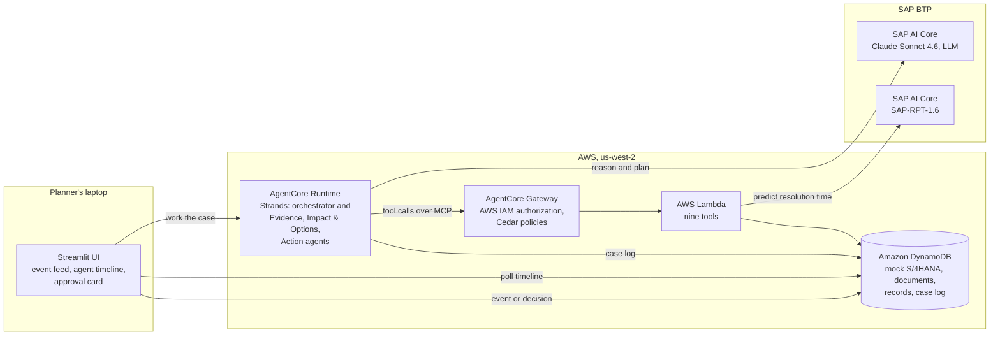
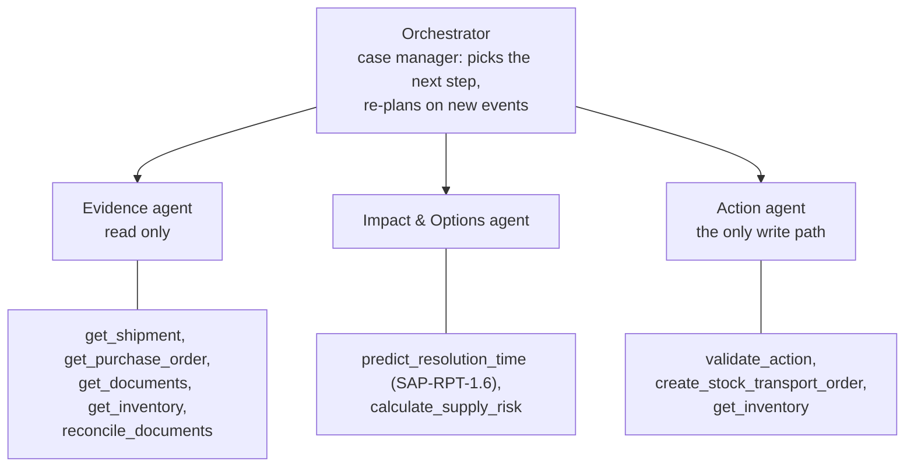

# CLEAR architecture

CLEAR turns a cross-border shipment exception into a validated recovery
plan. Its design rule: **the LLM proposes, code computes and validates, a
human approves.**

## Deployed system

| Part | What it does |
|---|---|
| Logistics event feed (simulated) | Starts a case; in production the same payload would come from Amazon EventBridge |
| AgentCore Runtime | Runs the four agents in one process, with a case-log hook on every agent |
| LLM | Claude Sonnet 4.6 in SAP AI Core's generative AI hub, called with the Bedrock Converse API; one setting (`CLEAR_LLM_BACKEND`) switches the agents to Amazon Bedrock |
| AgentCore Gateway | The only way to the tools; authorizes each call with IAM and Cedar policies |
| Lambda tools | Deterministic Python: every number comes from data or from code, never from the LLM |
| DynamoDB | Mock S/4HANA with the entity and field names of SAP's published APIs, plus documents, records, and the case log |
| SAP-RPT-1.6 | Predicts how long the exception will take, from past exceptions; falls back to a baseline median and says so |

Locally the same agents and tools run in one Python process on JSON files.
Deployment details: [deployment.md](deployment.md).

## Agents and tools

The orchestrator chooses the path per exception. A document hold starts
with reconciling the documents; port congestion starts from inventory
exposure. When the validator rejects a transfer, or a new event arrives,
the orchestrator re-plans.

## Where the numbers come from

| Number | Source |
|---|---|
| Stock, safety stock, orders | Mock S/4HANA, read by the tools |
| Document fields | Extracted by the LLM with quotes; `reconcile_documents` checks each quote against the document and compares the values |
| Resolution time | SAP-RPT-1.6, or the baseline median when it is unavailable; every prediction names its source |
| Coverage, shortage, deferred orders, cost | `calculate_supply_risk`, deterministic |
| Feasible transfer | `validate_action`, deterministic |
| STO quantity | Taken from the validation record, so it equals what was validated and approved |

Agents pass only IDs and decision variables to the tools. A recovery plan
cites record IDs (prediction, assessments, validation), and the UI fills in
every number from those records: the LLM cannot mistype a quantity into the
system.

## Governance: five layers before an STO exists

1. **Tool contract.** The write tool takes a `validation_id` and an `approval_id`, nothing else.
2. **Validator.** Four business rules: the source plant stays above safety stock, the transfer arrives in time, no over-transfer, the right material and plants.
3. **Human approval.** A planner approves or rejects on a card that shows the plan, the validation, and the source of every number.
4. **Gateway policy.** Cedar, outside the agents: each agent's IAM role may call only its own tools, and the STO write is forbidden unless the Action agent calls it with an approval ID.
5. **Code check.** The tool verifies that the approval exists, is for that validation, is an approval and not a rejection, and has not been used before.

Every step lands in the case log, which serves as the timeline, the audit
trail, and the case state that lets a run pause for approval and resume.
