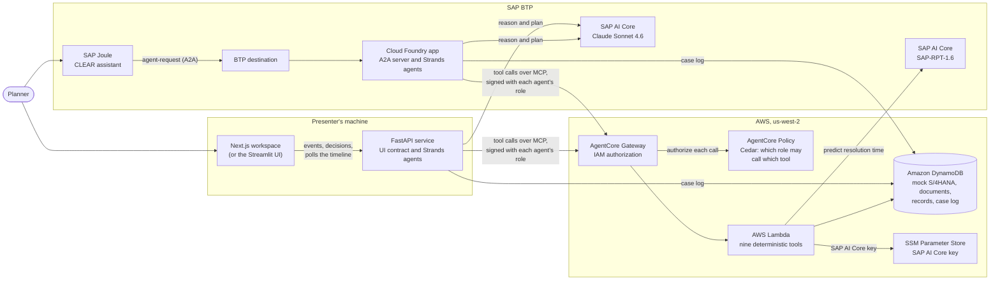
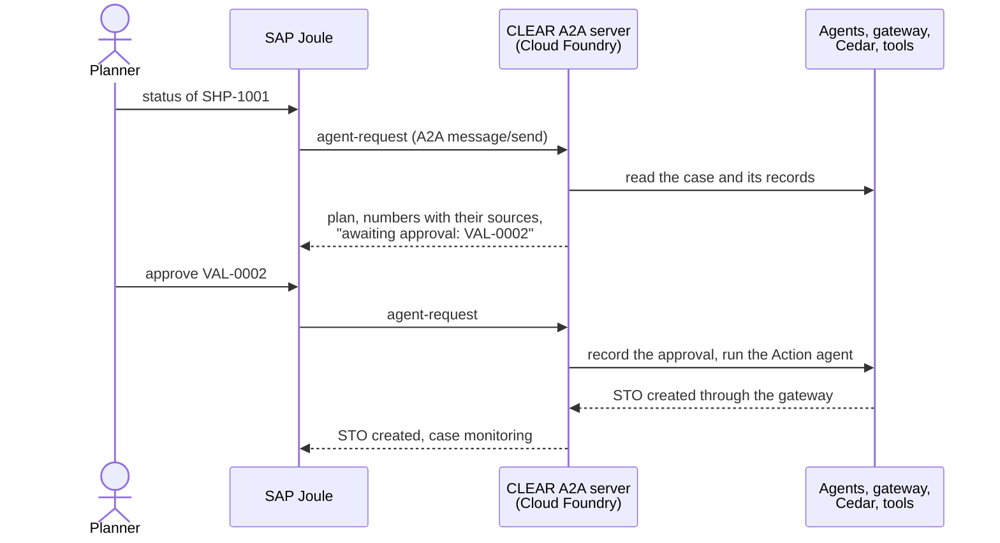
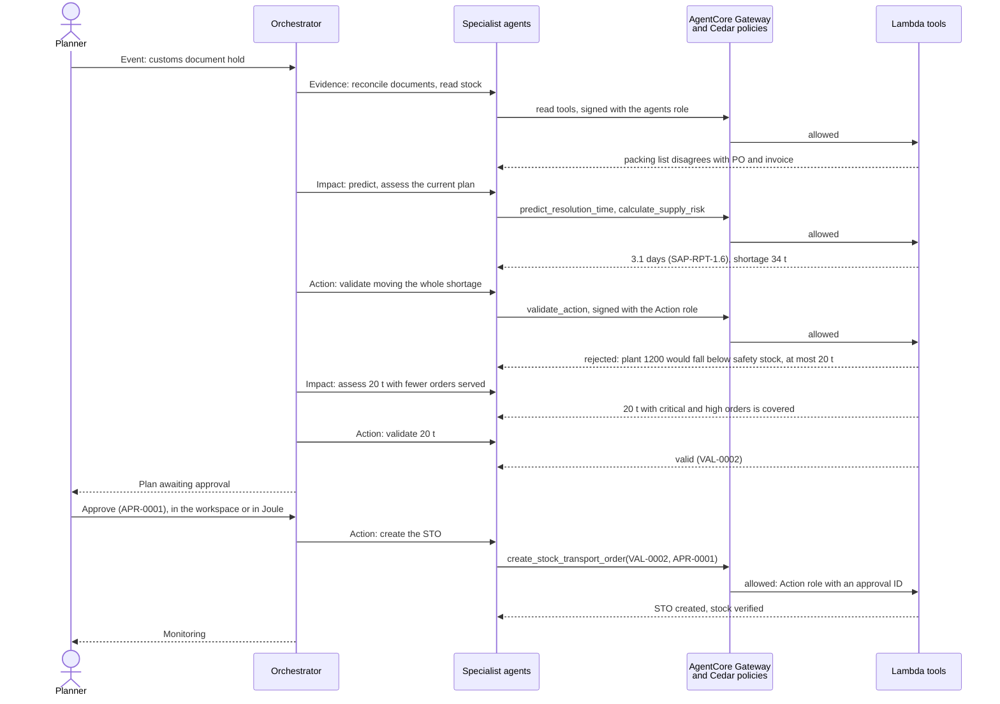
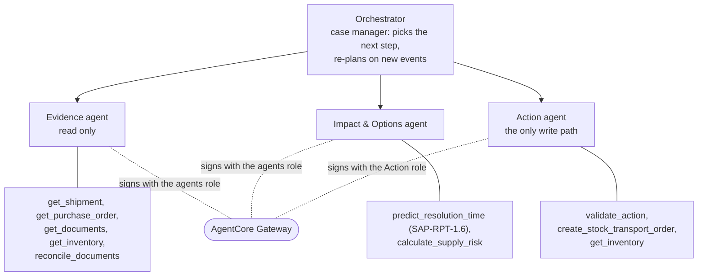

# CLEAR architecture

CLEAR turns a cross-border shipment exception into a validated recovery
plan. Its design rule: **the LLM proposes, code computes and validates, a
human approves.**

SAP provides the AI and the planner's assistant: the agents reason with
Claude Sonnet 4.6 and predict resolution times with SAP-RPT-1.6, both in SAP
AI Core, and a planner can work a case from SAP Joule. AWS provides the
agent infrastructure and its governance: the agents are built with Strands,
and every tool call passes AgentCore Gateway, where Cedar policies decide
which agent may call which tool, before the tools run in AWS Lambda on
DynamoDB.

## Deployed system

| Part | What it does |
|---|---|
| Logistics event feed (simulated) | Starts a case; in production the same payload would come from Amazon EventBridge |
| Next.js workspace and FastAPI service | The planner's workspace: event feed, live agent timeline, documents, inventory, approval desk; FastAPI serves the UI contract ([web-development.md](web-development.md)). The Streamlit UI offers the same workflow |
| SAP Joule | The planner can start a case, read its status and plan, and approve or reject a validated transfer in Joule; Joule calls CLEAR over A2A |
| Strands agents | The orchestrator and three specialists, with a case-log hook on every agent; they run in the FastAPI (or Streamlit) process for the workspace, and in a Cloud Foundry app on SAP BTP for Joule |
| Claude Sonnet 4.6 | The agents' LLM, in SAP AI Core's generative AI hub, called with the Bedrock Converse API; one setting (`CLEAR_LLM_BACKEND`) switches the agents to Amazon Bedrock |
| AgentCore Gateway | The only way to the tools; each agent signs its calls with its own IAM role |
| AgentCore Policy | Cedar policies on the gateway: the reading agents' role may only read and assess; only the Action agent's role may validate and write, and the STO write needs an approval ID |
| Lambda tools | Deterministic Python: every number comes from data or from code, never from the LLM |
| DynamoDB | Mock S/4HANA with the entity and field names of SAP's published APIs, plus documents, records, and the case log; shared by every front door, so a case started in one shows in the others |
| SAP-RPT-1.6 | Predicts how long the exception will take, from past exceptions; falls back to a baseline median and says so |

## Where it runs

The same code runs in four configurations:

| Configuration | Agents | Tools and data | Used for |
|---|---|---|---|
| Local | Presenter's machine | In the same process, on JSON files in `data/runtime/` | Development, tests, and the demo's fallback when the network fails |
| Gateway (deployed) | Presenter's machine, in the FastAPI or Streamlit process | AgentCore Gateway, Lambda, DynamoDB, Cedar policies | The demo in the workspace |
| Joule (deployed) | Cloud Foundry app on SAP BTP | AgentCore Gateway, Lambda, DynamoDB, Cedar policies | The demo in Joule |
| Runtime | AgentCore Runtime | AgentCore Gateway, Lambda, DynamoDB, Cedar policies | Built and tested with stand-ins; not deployed, because the team's AWS account has no AgentCore Runtime quota |

Deployment details: [deployment.md](deployment.md).

## SAP Joule as a front door

- Joule chooses CLEAR's skill and forwards the planner's message. CLEAR does
  not use an LLM to read the message: it matches IDs and keywords
  (`clear_app.joule`), and an approval must name the validation it approves.
- Joule waits at most 60 seconds for an answer, and a case takes 24 to 136
  seconds. CLEAR answers within 40 seconds: a run continues in the
  background, the answer shows its latest steps, and the planner asks for
  the status again.
- Every number in the answer is read from the case records, as in the
  workspace. The approval is recorded as "Planner via Joule": the
  destination's credentials identify Joule, not the person; a production
  setup would pass the user's identity through.

## A case, step by step

S1 with the planner's approval, in the deployed configuration:

The numbers are from a live run; the timeline in the workspace shows the
same steps as they happen.

## Agents and tools

The orchestrator chooses the path per exception. A document hold starts
with reconciling the documents; port congestion starts from the impact
assessment. When the validator rejects a transfer, or a new event arrives,
the orchestrator re-plans.

## Where the numbers come from

| Number | Source |
|---|---|
| Stock, safety stock, orders | Mock S/4HANA, read by the tools |
| Document fields | Extracted by the LLM with quotes; `reconcile_documents` checks each quote against the document and compares the values |
| Resolution time | SAP-RPT-1.6, or the baseline median when it is unavailable; every prediction names its source |
| Coverage, shortage, deferred orders, cost | `calculate_supply_risk`, deterministic |
| Feasible transfer | `validate_action`, deterministic; a transfer counts as infeasible only on a validation that says so |
| STO quantity | Taken from the validation record, so it equals what was validated and approved |

Agents pass only IDs and decision variables to the tools. A recovery plan
cites record IDs (prediction, assessments, validation), and the workspace
and Joule fill in every number from those records: the LLM cannot mistype a
quantity into the system. The plan check rejects a plan that cites a record
that does not exist, or that defers orders without a transfer and without
telling a human.

## Governance: five layers before an STO exists

1. **Tool contract.** The write tool takes a `validation_id` and an `approval_id`, nothing else.
2. **Validator.** Four business rules: the source plant stays above safety stock, the transfer arrives in time, no over-transfer, the right material and plants.
3. **Human approval.** A planner approves or rejects in the workspace, which shows the plan, the validation, and the source of every number, or in Joule, where the approval must name the validation.
4. **Gateway policy.** Cedar in AgentCore Policy, outside the agents: each agent's IAM role may call only its own tools, the STO write is forbidden unless the Action agent's role calls it with an approval ID, and an administrator without these roles reaches no tool at all. This holds for the agents on the presenter's machine and on SAP BTP alike.
5. **Code check.** The tool verifies that the approval exists, is for that validation, is an approval and not a rejection, and has not been used before.

Every step lands in the case log, which serves as the timeline, the audit
trail, and the case state that lets a run pause for approval and resume.
